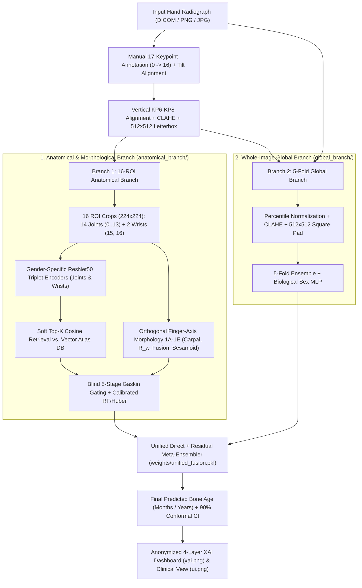

# System Architecture & Technical Specification (`Unified Pediatric Bone Age Pipeline`)

This document details the end-to-end architecture, clinical algorithms, privacy guarantees, and benchmark evaluation of the **Unified Pediatric Bone Age Assessment & 4-Layer Explainable AI (XAI) Pipeline**.

---

## 1. Architectural Overview

The pipeline integrates **two complementary deep learning paradigms** with an automated **clinical morphology engine** grounded in **Greulich & Pyle (G&P)**, **Tanner-Whitehouse (TW3)**, and **Gaskin (2011)**:

1. **Anatomical Branch (`anatomical_branch/`) — 16-ROI Vector Atlas Retrieval + Clinical Morphology (1A–1E)**:
   - **Manual 17-Keypoint Pose Standardization (`preprocess_hospital.py`)**: Uses 17 manually annotated anatomical hand keypoints (`0 -> 16`) via an interactive OpenCV GUI (or loads saved coordinates from `samples/sample_keypoints.json` / `outputs/xai_results/manual_annotations.json`), rotates the hand so the middle-finger axis (`KP6 -> KP8`) is vertical, applies `CLAHE` in LAB space, letterboxes to `512×512`, and snaps phalangeal keypoints onto the bone ridge.
   - **16 Anatomical ROIs**: Crops 14 phalangeal joints (`ROI 0..13`: DIP, PIP, MCP, Thumb IP/MCP) and 2 wrist regions (`ROI 15` Carpal Cavity, `ROI 16` Distal Radius & Ulna) at `224×224` resolution.
   - **Automated Morphological Feature Extraction (`clinical_algorithm.py`)**:
     - **[1A] Carpal Ossification (`ROI 15`)**: Adaptive Otsu/percentile thresholding + morphological opening to count carpal centers (`n_carpal` $\in [0, 8]$) and cavity occupancy ratio.
     - **[1B] Epiphyseal-to-Metaphyseal Width Ratio ($R_w = W_e / W_m$, `ROI 0..13`)**: Measured strictly orthogonal to each individual phalangeal bone axis.
     - **[1C] Physeal Fusion Score ($F_r \in [0, 1]$, `ROI 0..13`)**: Quantifies growth plate closure from the axial intensity valley between the epiphysis and metaphysis.
     - **[1D] Adductor Sesamoid Detection (`ROI 13` - Thumb MCP1)**: Difference-of-Gaussians (DoG) prominence detector inside an axis-aligned palmar search polygon.
     - **[1E] Distal Radius-Ulna Fusion (`ROI 16`)**: Bone-gated Sobel edge magnitude and growth plate fusion score.
   - **Soft Top-K Atlas Retrieval & Blind Gaskin Stage Gating**:
     - Gender-specific ResNet50 Triplet Encoders (`encoder_{male,female}_{joints,wrists}_ep5.pt`) project each ROI into a `2048-D` embedding space and retrieve the Top-$K$ ($K=10$) nearest neighbors from `weights/atlas_db/{gender}/roi_*.pt`.
     - Classifies the radiograph into **Biological Maturity Stages 1–5** without ground-truth age, gates out `SATURATED` or `OUTLIER` ROIs, and combines stage-weighted clinical aggregation with calibrated `RandomForest` + `HuberRegressor` models.

2. **Global Branch (`global_branch/`) — 5-Fold Whole-Image Ensemble**:
   - Uses a 5-Fold cross-validated whole-image architecture (`weights/global_folds/fold_0..4/best.pt`) with percentile intensity normalization, `CLAHE`, `512×512` square padding, and a dedicated biological sex MLP fusion head.

3. **Unified Champion Fusion (`run_pipeline.py`)**:
   - Combines cross-anchor outlier-gated anatomical group predictions (`G7_mat`), direct meta-features (`Ridge`, `RandomForest`, `ExtraTrees`, `GradientBoostingRegressor`), and residual corrections over the global prediction (`weights/unified_fusion.pkl`).

---

## 2. End-to-End Workflow Diagram

---

## 3. Strict Privacy & De-Identification Design

Every data file, sample image, and visual output in this repository enforces strict medical de-identification:
- **Zero Patient Identifiers**: No patient IDs, hospital accession numbers, or patient names appear in any CSV file (`prediction_results.csv`, `sample_metadata.csv`, `hospital_features_anonymized.csv`) or image filename.
- **Anonymized Visual Headers**: Both `xai.png` and `ui.png` display **only**:
  - `Real Age` (when provided)
  - `Predicted Age`
  - `Error (MAE)`
- **Compact Visual Atlas Bank (`weights/atlas_visual_crops.pt`, `18.4 MB`)**: Pre-encodes representative `224×224` reference bone crops per `(gender, roi_idx, age)` so the `[2. Atlas Sim]` comparison panel in `xai.png` renders out-of-the-box without requiring the multi-gigabyte raw training dataset.

---

## 4. Benchmark Evaluation (5-Fold Out-of-Fold Clinical Validation, $N = 723$)

| Cohort / Metric | Evaluated Cases ($N$) | Mean Absolute Error (MAE) | Median Absolute Error |
| :--- | :---: | :---: | :---: |
| **Overall Clinical Cohort** | `723` | **`8.67 months`** | **`6.44 months`** |
| **Female Cohort** | `548` | **`7.86 months`** | **`5.94 months`** |
| **Male Cohort** | `175` | **`11.20 months`** | **`9.30 months`** |
| **Ages 4–12 Years Subgroup** | `627` | **`8.45 months`** | — |
